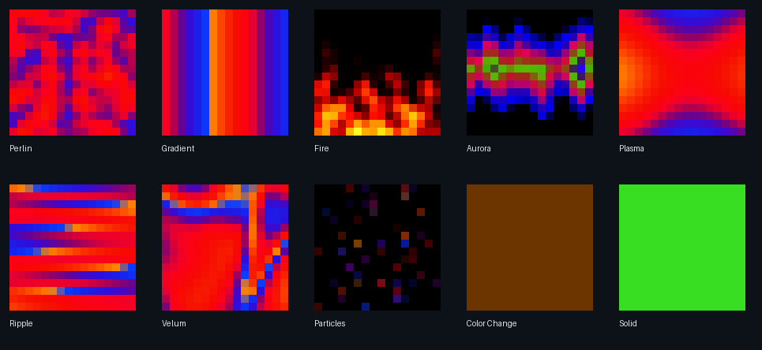

# ESP LED Music Lab

**Make your LED strips and matrices react to music — right in your browser.**

ESP LED Music Lab is a music player, LED-effect playground and companion app
for [ESP LED Lamp](https://github.com/DrA1ex/esp_led_lamp).
Preview light effects without hardware, adjust how they respond to sound,
or stream them to one or more real lamps over Wi-Fi.

**[Open Music Lab](https://dra1ex.github.io/esp_led_lab/)** ·
[Getting started](docs/USER_GUIDE.md) ·
[Explore effects](docs/EFFECTS.md)



*Examples of built-in color effects. Music Lab also includes sound-reactive
visualizations; the live LED preview shows how your selected effect responds
before you connect a lamp.*

## What can it do?

- **Play your music.** Add audio files or whole folders, drag and drop tracks,
  manage a playlist, or start with the built-in demo beat.
- **React to live sound.** Use your microphone instead of a music file.
- **Explore effects instantly.** Browse visualizations, color effects and
  79 palettes with visual previews; see the result before touching a lamp.
- **Control real lamps.** Stream audio-reactive features over the local
  network. The browser processes the audio; raw audio is not sent to the lamp.
- **Use multiple lamps.** Give every lamp its own effects, brightness limit
  and layout, or control them together with **All lamps**.
- **Fine-tune the reaction.** Shape frequency bands, sensitivity, beat
  tracking, noise floor and response curves while watching the analyzer.
- **Fit your LEDs.** Preview single-row strips, rings, multi-row layouts and
  matrices. Adjust orientation and offset to match your installation.

The app runs on desktop and mobile browsers; the layout adapts to narrower
screens. An ESP device is optional unless you want to control real lights.

## Get started

1. Open **[Music Lab](https://dra1ex.github.io/esp_led_lab/)** in Chrome.
2. Click **Add files** or **Open folder** to play your own music. For a quick
   demonstration, open the **⋯** menu beside Music and choose **Demo beat**;
   you can also choose **Microphone**.
3. Open **Reaction** to pick a visualization or audio mode. Use **Effect**
   to select a color effect, palette and brightness.
4. Choose the **LED layout** above the preview, or open **Layout** to adjust
   the LED mounting and orientation.

To use an actual lamp, follow the connection steps below. For an overview of
every control, see the [user guide](docs/USER_GUIDE.md).

## Discover the effects

There are effects for every kind of music response, from quiet ambient light
to flashes and motion synchronized to the beat.

| What you want to see | Try these effects |
|---|---|
| **Spectrum and frequencies** | Spectrum Bars, Flow, Radial Spectrum, Fire |
| **Overall loudness** | VU Meter, Waveform, Mood, Aurora, Lava Lamp |
| **Bass and percussion** | Pulses, Sparkles, Energy, Water, Blobs |
| **Rhythm and motion** | Groove, Scroll, Juggle |
| **Pitch and harmony** | Melody, Chromatic Flow |
| **Your own patterns** | Particles, Field, Zones |

Choose an effect in **Reaction**. When it supports additional parameters,
Music Lab shows them automatically — for example particle motion, fire
settings, contrast or blur. Color effects and palettes are available in
**Effect**.

For a description of each family and tuning options, see the
**[effects guide](docs/EFFECTS.md)**.

## Connect your lamps

The preview works without hardware. To send it to real LEDs, use firmware
with [Remote Audio support](https://github.com/DrA1ex/esp_led_lamp).

1. Connect the lamp and the device running Music Lab to the same local network.
2. Open **Lamps**, enter the lamp's local IP address (such as
   `192.168.1.42`) or `esp_lamp.local`, and add it.
3. Click **Connect all**. In Chrome, allow **Local Network Access** if prompted.
4. Select **All lamps** to control them together, or choose an individual lamp
   above the preview to customize its settings.

Chrome supports local `ws://` WebSocket connections from the hosted HTTPS
page with local-network permission. Other browsers may restrict access; in
that case run the app locally (instructions below). The lamp must be reachable
on your LAN; an HTTPS site cannot connect through a router to an unavailable
device.

Music Lab sends audio features, not the music itself. See the
[connection and troubleshooting guide](docs/USER_GUIDE.md#browser-and-network-access)
or [Remote Output details](docs/REMOTE_OUTPUT.md) for compatibility notes.

## Explore and customize

| Panel | What you can do |
|---|---|
| **Music** | Play tracks and folders, shuffle, repeat, or use the mic/demo beat |
| **Effect** | Choose an effect, palette, color and brightness |
| **Reaction** | Select sound-reactive modes, visualization settings and response range |
| **Lamps** | Connect and manage one or multiple ESP LED lamps |
| **Analyzer** | See FFT, frequency bands, onsets, tempo and detailed DSP diagnostics |
| **Layout** | Adjust rings, orientation and offsets to match the actual LED wiring |

Most settings are remembered in the browser. The analyzer's defaults are
designed to be useful without tuning; advanced controls are explained in
the [analyzer guide](docs/ANALYZER.md). For differences between the simulated
preview and real LEDs, see [accuracy and orientation](docs/ACCURACY.md).

## Run locally or offline

The [hosted version](https://dra1ex.github.io/esp_led_lab/) is the easiest
way to start. You can also build and run it yourself:

```sh
make             # compile WebAssembly and build dist/standalone.html
make serve       # serve the development app at http://localhost:8000/
```

Open `dist/standalone.html` for a self-contained offline version. Building
requires LLVM with WebAssembly support; the
[development guide](docs/DEVELOPMENT.md) covers dependencies and tests.
The microphone needs HTTPS or localhost permission.

## Documentation

- **[User guide](docs/USER_GUIDE.md)** — music playback, panels, multiple lamps,
  LED geometry and browser permissions
- **[Effects guide](docs/EFFECTS.md)** — visualization families, parameters
  and audio reactions
- **[Analyzer guide](docs/ANALYZER.md)** — DSP settings, graphs and signal tuning
- **[Development and testing](docs/DEVELOPMENT.md)** — source layout,
  WebAssembly build, offline bundle and tests
- **[Remote Output](docs/REMOTE_OUTPUT.md)** — audio feature protocol, device
  compatibility and troubleshooting
- **[Accuracy and orientation](docs/ACCURACY.md)** ·
  **[Revision history](docs/HISTORY.md)**

<!--
Additional screenshots should be uploaded using GitHub's issue/PR editor, then
embedded here with https://github.com/user-attachments/assets/... links.
Suggested captures: the playlist and preview; the Effect/Reaction picker with
palettes; Lamps with multiple devices; Analyzer DSP view. Do not add new image
files to the repository for this gallery.
-->
